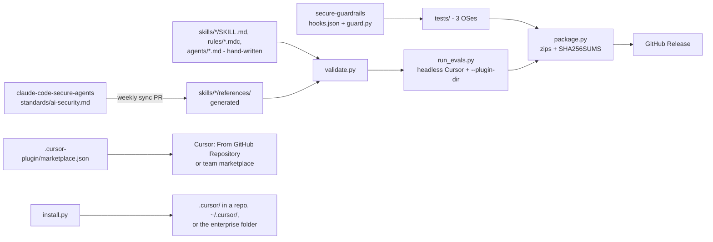

# Architecture

## Components

| Component | Role |
|---|---|
| `.cursor-plugin/marketplace.json` | Lists the two plugins, so Cursor can import the repository from GitHub or a team marketplace. |
| `plugins/secure-coding/` | A Cursor plugin with `skills/` (6, each with the standard in `references/`), `rules/` (2 `.mdc`), `agents/` (2 read-only subagents) and its manifest. |
| `plugins/secure-guardrails/` | A Cursor plugin with `hooks/hooks.json` (4 hooks) and `scripts/guard.py` (Python standard library, no network). |
| `skills.json` | Skill list, licence per skill, and the kit repo and ref the standard comes from. |
| `scripts/sync_from_kit.py` | Splits the kit's standard into one file per section and writes it into every skill. |
| `scripts/validate.py` | Checks the marketplace, manifests, skills, rules, subagents and hooks against Cursor's documented formats, plus budgets, licences, secrets and executables. |
| `scripts/install.py` | One-time setup for every project (user scope), or project or enterprise scope; merges `hooks.json` safely; self-updates to release tags. |
| `scripts/session_start.py` | Installed as a `sessionStart` hook: adds the security rule to every chat and starts the daily update check in the background. |
| `scripts/run_evals.py` | Real headless Cursor sessions per eval case. |
| `scripts/package.py` | Reproducible plugin and skill zips plus `SHA256SUMS`. |

## Design decisions

1. **Two plugins, not one.** Skills, rules and subagents guide the model; hooks enforce policy. Teams often roll them out separately: hooks change what developers can run and may need change approval. Splitting them lets each be installed, versioned and governed on its own.
2. **Rules for always-on basics, skills for depth.** The always-on rule is about 450 tokens and is sent with every request, so it holds only rules that apply to all code. Procedures live in skills, which load only when relevant, and the standard loads one section at a time.
3. **Hooks fail safely.** `guard.py` always prints valid JSON (Cursor treats invalid output from a permission hook as a block), never echoes secrets, and fails open by default so a broken Python install doesn't stop work. Enterprises choose fail-closed with `--fail-closed`.
4. **Policy can tighten, never relax.** `.security/rules.md` and `.security/guardrails.json` only add rules. Enterprise hooks outrank every other level, and `deny` beats `allow` when hooks merge.
5. **One source of truth for the standard.** The kit tracks OWASP, NIST, MITRE ATLAS and tooling changes; this repository syncs it weekly through a reviewed pull request and fetches nothing at run time.
6. **Set up once, then hands-off.** Skills, subagents and hooks live in the user's `~/.cursor/`, which Cursor applies to every workspace. The always-on rule reaches every chat through a `sessionStart` hook. Updates follow release tags on `main` only, so a half-finished change on `main` never reaches users.
7. **Defence in depth for read-only subagents.** Cursor does not yet enforce `readonly` for plugin-shipped subagents, so their prompts also forbid edits, and the installer can place them in `.cursor/agents/`, where `readonly` is enforced.

## Release flow
1. Change a component, or merge the weekly sync PR.
2. CI runs the validator, the tests on three operating systems, and the packager on every push and PR. The Evals workflow runs when skills, rules, subagents or evals change.
3. Bump versions: the skill's `metadata.version`, the plugin's `version` and the marketplace's `metadata.version` (`scripts/bump.py` does the patch bump).
4. Update [CHANGELOG.md](../CHANGELOG.md), merge, and push a tag matching the marketplace version, e.g. `v1.0.1`. `release.yml` publishes the zips and `SHA256SUMS`.
